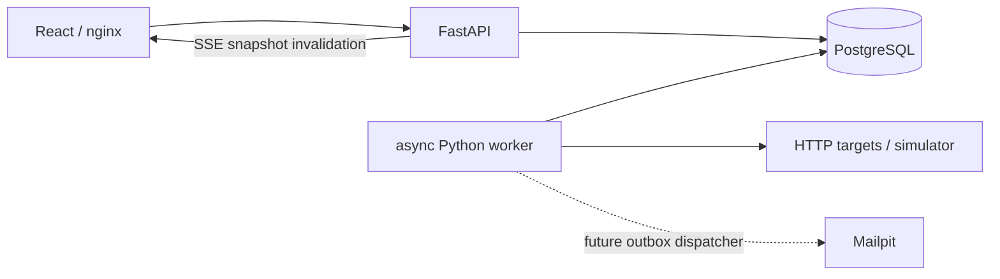

# Architecture — monitor management checkpoint and target design

The owner prescribed this stack; this design keeps it. Shipped scope includes foundation,
versioned monitor CRUD/pause/resume, group membership/recipients and real HTTP observations.
Later incident, outbox, maintenance and public components below are
**designs**, not implementation claims. See requirements.md for individual status.

## Services and boundaries

- Frontend: React, TypeScript, Vite production build, nginx same-origin /api proxy.
  Dark operations console, native form validation, semantic table, honest empty/error states.
- API: FastAPI + Pydantic + SQLAlchemy async sessions, Alembic schema. Create/list/detail/history,
  enqueue run-now, health/readiness and SSE snapshots in the first slice.
- Worker: separate process; bounded asyncio tasks and one pooled HTTPX client. Claims due
  monitors using PostgreSQL `FOR UPDATE SKIP LOCKED`. A UUID claim token and expiring lease
  fence stale workers. HTTP total deadline is shorter than the lease. No backfilled checks.
- PostgreSQL: authoritative config, results, groups, recipients and scheduling state. Later incidents/outbox
  are separate tables added through reviewed migrations.
- Simulator: controllable local HTTP status, delay, body and redirect responses; no external dependency.
- Mailpit: local SMTP capture included in Compose; dispatch is a later phase.

## Persisted model (Alembic 0001 + additive 0002)

Monitor: UUID, name, URL, interval (30..3600 seconds), timeout (0.1..120 seconds), expected
status (100..599), optional expected string, failure threshold (1..10, default 2), state,
consecutive failures, last observation/status/latency, next due time, lease token/expiry,
config_version and a coalesced manual-run request flag.
CheckResult: UUID, monitor FK with cascade delete, timestamp, success, HTTP code, latency,
bounded error category. Composite index (monitor_id, checked_at) supports recent history.
Each result carries the configuration version used. Schema constraints enforce bounds;
times are UTC timestamptz. Group stores name/version; MonitorGroup is a many-to-many join
with cascading FKs and a monitor lookup index; GroupRecipient has unique (group_id,email).
Deleting a group never deletes its monitors. Deleting a monitor removes its memberships/results.

## Target model (not migrated yet)

Incident has monitor FK, opened_at, recovered_at; partial unique index permits one open
incident per monitor. MaintenanceWindow targets exactly one monitor or group, has start/end
and end > start constraint. Outbox uses unique (incident_id, group_id, event_type), frozen
recipient payload, attempts, next_attempt_at, lease, sent_at. PublicPage + publication join
table selects public name and state only; no private URL, errors, recipients or config.

## State and incident policy

Initial UNKNOWN. First success → UP. First failure preserves UNKNOWN or UP until threshold
consecutive failures; threshold (default two) → DOWN. Success resets failures and → UP.
The threshold reduces false alerts without an extra state. An HTTP response must match both
status and optional body string. Manual runs use the same queue/claim and state rules.
State is computed; **incident records and alert delivery are not implemented**.

PAUSED prevents scheduled/manual launches. Resume schedules immediately, clears the streak
and sets UNKNOWN until a new observation. Every configuration edit increments its version,
clears current metrics/streak and sets UNKNOWN (or retains PAUSED); old history is retained.
Even rename-only edits follow this conservative rule. Target incident phase must reconcile
these edits with open incidents; current state changes do not create/close incident records.
Group: DOWN if any active member DOWN, otherwise UNKNOWN if any active member UNKNOWN,
otherwise UP; all paused → PAUSED; empty → UNKNOWN. Maintenance is a badge/policy, never UP.
Group recipients are validated with Pydantic EmailStr/email-validator and normalized/deduplicated,
up to 100 addresses. Deliverability and actual sending are not checked in this phase.

## Concurrent mutations

PUT monitor/group and pause/resume require the captured config_version. A row lock serializes
the version comparison and mutation; mismatch returns 409 and the browser preserves the draft.
Reloading a conflicting draft is explicit. Group membership/recipients are replaced atomically
in one transaction, with group lock followed by monitor locks sorted by UUID. Group changes
do not modify monitor configuration versions, so independent edits can both succeed.
Group responses are built before committing while the group lock is held, avoiding a
read-after-commit delete race. Cascade removal of a deleted monitor does not bump group
version; submitting an unknown monitor ID is rejected instead of silently restoring it.
Monitor DELETE accepts an optional version for compatibility; browser DELETE always includes
it. Unversioned API DELETE remains intentionally unconditional; trusted API callers own that choice.

Active leases are **never cleared by edits/pause/resume**. Worker checks version/state before
network I/O and at commit; stale work releases its own lease without recording a result.
Thus changing URL or pause/resume cannot immediately launch a parallel request. The old
HTTP request may finish, but its outcome is ignored. Deleting a monitor fences completion
by absence of the row. Worker crash retains the lease until expiry; no fabricated observation.
Manual requests coalesce through run_requested; queued/running/paused returns 409. If an old
completion arrives after a manual request on an expired lease, the pending request stays due.

## Scheduling, crashes and races

Each tick claims only free capacity (default 50). Claim commits before network I/O. Lease is
timeout + 15 seconds. Completion locks the row and checks the token before committing result
and state. A process crash leaves a recoverable lease, not a synthetic failure. Due time is
completion + interval (fixed delay; no catch-up storm). A run-now while leased returns 409.
HTTP work has an outer asyncio deadline covering DNS and streaming. Cancellation releases no
fake observation: restart waits for lease expiry. First slice supports multiple workers via
DB claims; restart, multi-worker and 50-monitor performance still require dedicated tests.

## Notifications and maintenance (target)

State transition + incident + outbox insert share a transaction. Two consecutive failures open
an incident; repeated failed checks do not create new logical events. Maintenance does not stop
checks. Effective suppression is the union of monitor and group windows. At every dispatcher
tick re-evaluate windows and open incidents; enqueue deferred DOWN after last window ends if
still down. If recovered during maintenance, suppress the deferred alert; send recovery only
to groups for which the DOWN event was delivered. Freeze recipients per event, back off SMTP
errors. SMTP acceptance + DB crash can duplicate physical delivery; do not claim exactly once.
Ordering between DOWN and recovery and pending-send maintenance races need transaction tests.

## Realtime and history

SSE retains the default monitor-array message for compatibility and adds a named `groups`
event every two seconds. Both snapshots read one REPEATABLE READ transaction. Native EventSource
reconnects and receives a complete snapshot: clients need no in-memory shared broadcaster.
This is low-volume polling over SSE, not PostgreSQL NOTIFY; scales to the assignment, not a
large fleet. First slice history returns the most recent 100 bounded results; monthly time
buckets, gaps, 24h/7d/30d availability and public projection are later work.
Uptime target definition: observed successful samples / all observed samples, with sample
count and coverage shown separately. Missing periods are gaps and excluded, never failures.

## SSRF and deployment

Only HTTP/HTTPS with no credentials, fragment or scoped IPv6. Resolve and validate **all**
addresses on each check; reject any non-global destination. Connect to the validated numeric IP
while retaining original Host and TLS SNI. Redirects are not followed. Proxies are disabled.
Connection: close prevents a numeric-IP connection pool from reusing one virtual host's TLS
session for a different host at the same IP. This sacrifices keep-alive reuse in the first
slice; HTTPX still bounds active connections. Body matching is UTF-8 with replacement.
Body uses identity encoding, streaming cap (1 MiB) and total deadline; encoded responses are
rejected to prevent decompression bombs. Explicit simulator origin bypasses private-IP block
only for that exact scheme/host/port. It is empty by default in code; example Compose opts in.
Network egress policy remains recommended defense in depth; unusual NAT/proxy routing is
outside application control. HTTPS SNI is based on HTTPX/httpcore extension, covered by source
reference and request-construction test; live external TLS validation remains NOT VERIFIED.

Management has no authentication and is intended for a trusted local machine. Compose binds
only to 127.0.0.1; PostgreSQL and simulator control ports are not published. Do not expose
management API publicly. Public-page routing isolation/auth hardening is required before hosting.

## Verification and delivery plan

0 discovery + requirement matrix → 1 foundation/migrations/build → first-slice checkpoint.
2 CRUD/groups → 3 incident engine, leases and concurrent edits → 4 maintenance/outbox/SMTP →
5 complete UI/public page → 6 integrated load/restart/privacy/security audit → 7 submission.
Unit tests cover state and URL policy. Integration tests use real disposable PostgreSQL.
Smoke script creates its own monitor, waits for worker result, verifies API/history/UI and removes
only that monitor. Later browser tests cover two clients, reconnect and public privacy; load
test records actual throughput/concurrency/lateness and history latency. CI runs lint, pytest
with PostgreSQL, frontend tests/typecheck/build. No future test is labeled passed.
