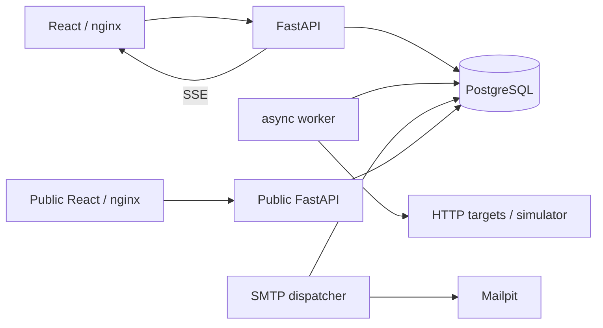

# Архитектура ServicePulse

Актуальная русская редакция от 21 октября 2026. Сохранены архитектура Phase6 и миграция 0006. Локализация меняет представление; API, схема данных, scheduler и правила уведомлений сохранены. Полное предыдущее описание доступно в истории Git на `f3866cd`.

## Сервисы

| Сервис | Назначение |
|---|---|
| Административный frontend/API | CRUD, группы, инциденты, обслуживание, аналитика, публикация и уведомления |
| Публичный frontend/API | Отдельные bundle, ASGI и nginx; разрешённые GET и публичный SSE |
| Worker | HTTPX/asyncio, до 50 одновременных проверок, сохранённые claims и leases |
| Dispatcher | Отдельный процесс доставки; сверка обязательств каждые 2 с независимо от HTTP |
| PostgreSQL | Единственный источник настроек, результатов, состояния и очереди уведомлений |
| Simulator и Mailpit | Настоящие HTTP и SMTP без писем внешним получателям |

Порты управления привязаны к 127.0.0.1. Авторизации нет: TrustedHost не заменяет её. Для размещения в интернете нужна отдельная защита управления. nginx повторно разрешает Docker DNS с TTL 2 с после смены IP backend, сохраняя URI и SSE.

## Данные

| Сущность | Основные поля и ограничения |
|---|---|
| Monitor | UUID, URL, интервал 30–3600 с, таймаут 0,1–120 с, ожидаемый HTTP-код 100–599, текст, порог 1–10; состояние, серия ошибок, метрики, next_due, lease, config_version |
| CheckResult | Время наблюдения, результат, HTTP-код, длительность, ограниченная причина; зафиксированные config_version и интервал |
| Group и membership | Состав, состояние по мониторам, адресаты и политика почты; связи FK |
| Incident | Начало, восстановление, причина закрытия; уникальный открытый инцидент для monitor |
| MaintenanceWindow | Начало и конец, ровно одна цель: monitor или group; ограничения времени и версии |
| NotificationEvent/Delivery | Уникальные логические события и доставки, сохранённые маршруты, eligibility, попытки, claims и подтверждение |
| PublicPage/Publication | По умолчанию отключена; slug, title, version; отдельный публичный ID, подпись и явное разрешение истории |

Индексы и FK создаются миграциями 0001–0006. Составной индекс `(monitor_id, checked_at)` поддерживает историю; частичный уникальный индекс защищает открытые инциденты. Удаление monitor отзывает публикацию. Изменение публикации не меняет lease, настройки проверки или инцидент.

## Состояния и выполнение

| Событие | Результат |
|---|---|
| Нет наблюдений | UNKNOWN |
| Первый успех | UP, серия ошибок сбрасывается |
| Ошибка ниже порога | Последнее подтверждённое состояние сохраняется; ошибка видна в результате |
| Достигнут порог, по умолчанию 2 | DOWN и один открытый инцидент |
| Успех после DOWN | UP, автоматическое закрытие с восстановлением |
| Pause/resume | PAUSED без очередных проверок; после resume новое состояние определяется наблюдением |
| Ручной запуск | Тот же HTTP и защита от пересечений; занятый monitor может вернуть 409 |
| Смена конфигурации | Текущие метрики и серия сбрасываются, история остаётся; прежний инцидент закрывается административно |
| Maintenance | Реальные результаты продолжают записываться; меняется политика писем |

Для группы: пустой состав — UNKNOWN; все на паузе — PAUSED; среди активных DOWN имеет приоритет над UNKNOWN, затем UP. Точные переходы проверяются тестами из [матрицы](phase7-final-acceptance.md).

Scheduler использует fixed-delay: следующая проверка назначается после завершения предыдущей. `FOR UPDATE SKIP LOCKED`, lease token и config version защищают от параллельных запусков и устаревших результатов. Медленный сайт занимает одну задачу в ограниченном пуле. Отмена и сетевые ошибки обрабатываются отдельно. После restart просроченные leases освобождаются; пропущенные наблюдения не создаются задним числом и не считаются падением.

## Уведомления и обслуживание

Результат, состояние, инцидент и событие outbox фиксируются транзакционно. Уникальные ключи предотвращают повторные логические события и доставки. Адресаты фиксируются; dispatcher отдельно выполняет claim, prepare, SMTP send и ack. Перед отправкой заново проверяется разрешённость. Уже отправляемое письмо отозвать нельзя.

Повторные ошибки одного инцидента не создают новые DOWN. Для новых инцидентов 0006 и runtime сохраняют eligibility: быстрое восстановление вне maintenance не отменяет обязательную пару DOWN→RECOVERY. У старых записей неизвестное eligibility не угадывается; массовые письма задним числом не создаются.

Пересекающиеся окна monitor/group учитываются совместно. Во время обслуживания наблюдения продолжаются, уведомления подавляются. Если DOWN сохраняется после окна, сверка создаёт обязательство без фиктивного CheckResult. Падение и восстановление целиком внутри обслуживания не порождают устаревшую пару писем.

Claims и ack защищены token. Временные ошибки повторяются с задержкой 5–300 с, максимум 8 попыток. Постоянный отказ или исчерпание попыток дают FAILED и требуют расследования. SMTP acceptance перед crash без ack может привести к физическому дублю. Message-ID стабилен, но exactly-once доставку во внешний mailbox SMTP не гарантирует.

## SSE, публичность и аналитика

Административный SSE каждые 2 с передаёт согласованный снимок в REPEATABLE READ. После reconnect клиент получает полное состояние; длительности обновляются локально каждую секунду. Два независимых клиента работают одновременно.

Публичная проекция не содержит URL, внутренние IDs, административные имена, email, ошибки или outbox. Каждый GET и SSE tick заново проверяет разрешения страницы, состава и истории. Неизвестный и запрещённый ресурс получают одинаковый 404. Ответы не кэшируются; при disconnect/revoke клиент очищает данные и не применяет поздний REST поверх отзыва. Уже полученные данные физически отозвать невозможно. Общая DB role остаётся ограничением: read-only transaction не равна отдельным правам PostgreSQL.

SQL-аналитика выполняет `SET LOCAL jit=off` и один ограниченный aggregate SELECT. Для 24 ч/7 д/30 д возвращается максимум 288/336/360 точек. Доступность — доля успешных наблюдений; покрытие рассчитывается отдельно по зафиксированным интервалам с объединением пересечений. Ручные серии и одинаковые timestamps не удваивают покрытие. Старый неизвестный интервал не восстанавливается догадкой. НЕТ ДАННЫХ отличается от реального нуля; пропуски не соединяются и не превращаются в ошибки. Пауза исключается из публичной freshness; устаревший DOWN показывается как последнее известное состояние с предупреждением.

## Безопасность и проверка

Разрешены HTTP/HTTPS, проверяются все DNS answers, используется numeric pinning с Host/SNI. Redirect и proxy отключены; таймаут и размер ответа ограничены. Исключение simulator задаётся явно для узкого origin. Отдельный живой TLS/SNI стенд, auth, минимальные DB privileges и egress firewall остаются дальнейшей работой.

`frontend/src/ru.ts` локализует отображение, native validation и ошибки. API fields, enum, option values и заголовки не переводятся; даты используют ru-RU. Сохранённые имена пользователя не меняются. Русские письма сохраняют X-ServicePulse-Event, Message-ID и дедупликацию.

Проверяются PostgreSQL/integration, component tests, настоящий Chromium в четырёх размерах, два клиента, reconnect, privacy, maintenance, Mailpit, чистое развёртывание и сбои доставки. Измерения нагрузки 20 октября отделены от регрессии 21 октября. Актуальные команды, результаты и ограничения — в [отчёте владельцу](OWNER_FINAL_REPORT_RU.md).
