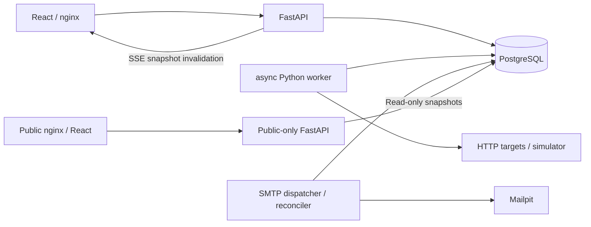

# Architecture — monitor management checkpoint and target design

Phase6 reliability amendment (in progress): additive0006 stores notification eligibility/obligation;
new confirmed incidents retain DOWN then RECOVERY outside maintenance even if dispatcher is delayed.
Maintenance/group mutations preserve earned obligations and terminally revoke removed routes under
parent/delivery locks. Historical unknown eligibility is not inferred or replayed.
See phase6-notification-policy.md for the transition table, recovery observation-time boundary and
SMTP limits. Worker now rejects expired preflight claims and refreshes a valid lease after its lock
wait. Public aggregate freshness excludes PAUSED services; a stale last DOWN is still displayed.
Management accepts only localhost/127.0.0.1/backend Host at ASGI and local hosts at nginx; keep
loopback binding. This does not add authentication or authorize public management deployment.
Earlier phase sections below describe their original contracts where superseded explicitly here.

The owner prescribed this stack; this design keeps it. Shipped scope includes foundation,
versioned monitor CRUD/pause/resume, group membership/recipients and real HTTP observations.
Persisted incidents, maintenance and transactional SMTP outbox now ship through phase 4.
Phase5 adds separate public ingress/ASGI/build, explicit publication models and bounded SQL analytics.
See requirements.md, phase4-design.md and phase5-design.md for exact contracts.

## Services and boundaries

- Frontend: React, TypeScript, Vite production build, nginx same-origin /api proxy.
  Dark operations console, native form validation, semantic table, honest empty/error states.
  nginx resolves backend through Docker DNS with a 2s TTL, preserving URI/SSE settings when container
  replacement changes the IP. A dedicated regression forces a different address without restarting UI.
- API: FastAPI + Pydantic + SQLAlchemy async sessions, Alembic schema. Create/list/detail/history,
  enqueue run-now, health/readiness and SSE snapshots in the first slice.
- Worker: separate process; bounded asyncio tasks and one pooled HTTPX client. Claims due
  monitors using PostgreSQL `FOR UPDATE SKIP LOCKED`. A UUID claim token and expiring lease
  fence stale workers. HTTP total deadline is shorter than the lease. No backfilled checks.
- PostgreSQL: authoritative config, results, groups, recipients, incidents, maintenance, outbox and scheduling state.
- Simulator: controllable local HTTP status, delay, body and redirect responses; no external dependency.
- Dispatcher: separate process, leased per-recipient work and two-second reconciliation independent of HTTP results.
- Mailpit: real local SMTP acceptance catcher with HTTP API evidence; no external relay/provider.

## Persisted model (Alembic 0001 + additive 0002/0003/0004/0005)

Monitor: UUID, name, URL, interval (30..3600 seconds), timeout (0.1..120 seconds), expected
status (100..599), optional expected string, failure threshold (1..10, default 2), state,
consecutive failures, last observation/status/latency, next due time, lease token/expiry,
config_version and a coalesced manual-run request flag.
CheckResult: UUID, monitor FK with cascade delete, timestamp, success, HTTP code, latency,
bounded error category. Composite index (monitor_id, checked_at) supports recent history.
Each result carries the configuration version used. Schema constraints enforce bounds;
times are UTC timestamptz. Group stores name/version; MonitorGroup is a many-to-many join
with cascading FKs and a monitor lookup index; GroupRecipient has unique (group_id,email).
Deleting a group never deletes its monitors. Deleting a monitor removes its memberships/results.

## Maintenance and outbox model (0004)

MaintenanceWindow targets exactly one monitor or group, has UTC start/end, end > start constraint,
version, FK cascades and target/time indexes. NotificationEvent is unique (incident_id,event_type).
NotificationRoute freezes group UUID/email at confirmation; NotificationDelivery is unique(event_id,email),
with persisted status/attempts/due time/lease token/send authorization/sent timestamp/bounded error.
The group route UUID is historical, deliberately not a FK (avoids reverse lock ordering); eligibility
requires live membership/recipients. Monitor deletion cascades incident/outbox; group deletion revokes routes.
See phase4-design.md for case normalization, frozen recipients, retries, ordering and SMTP uncertainty.

## Public model and boundary (0005)

PublicPage (disabled default, slug/title/version) + Publication (explicit monitor consent, unrelated
public ID, owner-supplied label, show_history false default) isolates publication from monitoring config.
Public ASGI has no management routes/OpenAPI. Its nginx/image exposes only public GET/SSE and public
bundle; private UI/API remain separate and trusted-local. Allowlisted projection never includes private
monitor IDs/names/URLs, group/recipient/config/error/window names or outbox data. Snapshot reads are
read-only transactions using a shared DB role, not role-level privilege isolation. Every SSE tick rechecks
enabled membership; history requires per-publication permission. No-store, no replay, reconnect fresh state.
See phase5-design.md and actual privacy tests for authorization/revocation boundaries.

## State and incident policy

Initial UNKNOWN. First success → UP. First failure preserves UNKNOWN or UP until threshold
consecutive failures; threshold (default two) → DOWN. Success resets failures and → UP.
The threshold reduces false alerts without an extra state. An HTTP response must match both
status and optional body string. Manual runs use the same queue/claim and state rules.
State, observation, incident and notification event/routes/deliveries commit atomically. SMTP runs outside that transaction.

PAUSED prevents scheduled/manual launches. Resume schedules immediately, clears the streak
and sets UNKNOWN until a new observation. Every configuration edit increments its version,
clears current metrics/streak and sets UNKNOWN (or retains PAUSED); old history is retained.
Even rename-only edits follow this conservative rule. Edits close open incidents with
CONFIG_CHANGED; pause closes with PAUSED. Neither is a successful recovery.
Group: DOWN if any active member DOWN, otherwise UNKNOWN if any active member UNKNOWN,
otherwise UP; all paused → PAUSED; empty → UNKNOWN. Maintenance is a badge/policy, never UP.
Group recipients are validated with Pydantic EmailStr/email-validator and normalized/deduplicated,
up to 100 addresses. SMTP acceptance is verified with Mailpit; external mailbox deliverability is not claimed.

## Phase 3 incident persistence and API

Incident stores UUID, cascading monitor FK, opened_at, closed_at, recovered_at, closure_reason,
created_at. All times use UTC timestamptz. opened_at is the completion time of the observation
that confirms DOWN, captured immediately after HTTP and before waiting for the persistence lock.
created_at records persistence processing time; these are distinct concepts. An observation's
checked_at equals this completion time. Recovery closes on the first valid successful observation.
Closed duration is closed_at - opened_at; open duration is max(0, now - opened_at). Clock rollback
clamps closing time to opened_at, preventing negative stored durations; this is not precision
timing across a host clock correction. HTTP latency remains measured by the monotonic clock.

The unique partial index is monitor_id WHERE closed_at IS NULL, rather than recovered_at IS NULL:
administrative closures intentionally leave recovered_at null. Constraints enforce matching closure
fields, nonnegative time and RECOVERED-only recovery timestamps. Incident/state/streak/result/lease
changes share the worker completion transaction and monitor row lock. Repeated failures keep the
same open ID; completion retry with an obsolete token cannot append another result. Transactions
roll back together after a PostgreSQL error. Mutation order is monitor lock, then incident lookup;
no network request runs inside a database transaction. Delete cascades incidents, as with results.
The journal joins the current monitor name, not a frozen historical name.

Migration 0003 creates no historical incidents and does not modify legacy DOWN rows. The next
valid failed observation on such a row opens one incident at that fresh observation's time;
its unknown earlier outage duration is excluded. A first success before a new failure creates no
fake recovery record. The migration harness preserves an actual v0.2 DOWN monitor, result, group,
recipient and configuration version. Pause/resume clears the streak and resumes UNKNOWN.

GET /api/incidents and /api/monitors/{id}/incidents return {items,has_more,limit,offset}.
Filters: monitor_id, state=OPEN|CLOSED, since/until (inclusive opened_at bounds with explicit
timezone); order=asc|desc with UUID tie-break. Limit 1..100 (default 50), offset 0..10000;
use time filters for deeper history. GET /api/incidents/active applies OPEN; /api/incidents/{id}
returns detail or 404. One joined query fetches limit+1 rows without a count query/N+1.
Indexes cover (monitor_id,opened_at,id), (opened_at,id), and the partial open-monitor key.

SSE retains monitor and group messages; a named incidents event sends the newest incident page
(default 50, same envelope as REST) from the same REPEATABLE READ snapshot every two seconds.
The journal treats each event as invalidation and refreshes its own filtered/paginated REST page,
so closing an older incident outside the newest 50 still updates the visible page. This adds
one bounded request per connected client per two seconds. Reconnect receives a full snapshot.
Open duration ticks every second in React; no backend or page refresh is needed for the clock.

The phase3 incident identity/closure semantics feed phase4 outbox. DOWN corresponds to confirmation,
RECOVERY only to closure_reason=RECOVERED; administrative closure never creates recovery mail.
Migration 0004 disables notifications on existing incidents, avoiding upgrade backfill/mass mailing.
New incidents explicitly enable notifications and create events in the existing completion transaction.

## Concurrent mutations

PUT monitor/group and pause/resume require the captured config_version. A row lock serializes
the version comparison and mutation; mismatch returns 409 and the browser preserves the draft.
Reloading a conflicting draft is explicit. Group membership/recipients are replaced atomically
in one transaction, with group lock followed by monitor locks sorted by UUID. Group changes
do not modify monitor configuration versions, so independent edits can both succeed.
Group responses are built before committing while the group lock is held, avoiding a
read-after-commit delete race. Cascade removal of a deleted monitor does not bump group
version; submitting an unknown monitor ID is rejected instead of silently restoring it.
Monitor DELETE accepts an optional version for compatibility; browser DELETE always includes
it. Unversioned API DELETE remains intentionally unconditional; trusted API callers own that choice.

Active leases are **never cleared by edits/pause/resume**. Worker checks version/state before
network I/O and at commit; stale work releases its own lease without recording a result.
Thus changing URL or pause/resume cannot immediately launch a parallel request. The old
HTTP request may finish, but its outcome is ignored. Deleting a monitor fences completion
by absence of the row. Worker crash retains the lease until expiry; no fabricated observation.
Manual requests coalesce through run_requested; queued/running/paused returns 409. If an old
completion arrives after a manual request on an expired lease, the pending request stays due.

## Scheduling, crashes and races

Each tick claims only free capacity (default 50). Claim commits before network I/O. Lease is
timeout + 15 seconds. Completion locks the row and checks the token before committing result
and state. A process crash leaves a recoverable lease, not a synthetic failure. Due time is
completion + interval (fixed delay; no catch-up storm). A run-now while leased returns 409.
HTTP work has an outer asyncio deadline covering DNS and streaming. Cancellation releases no
fake observation: restart waits for lease expiry. First slice supports multiple workers via
DB claims; competing claims, expiry, stale completion, cancellation and actual restart are now tested.
Sustained 50-monitor/30s cadence remains a separate mandatory performance experiment.

## Notifications and maintenance (implemented phase 4)

Full contract: [phase4-design.md](phase4-design.md). Suppression is evaluated per frozen group route;
a monitor window suppresses all routes, a group window only itself. Any allowed route can authorize
one shared-address delivery. Reconciliation advances pending delivery without fabricating HTTP results.
Queued unattempted DOWN is cancelled on recovery; recovery waits for known DOWN acceptance. An
uncertain in-flight/accepted-before-ack DOWN is retried before recovery, with possible physical duplicates.
Known rejection clears its authorization marker. Backoff is 5..300s, at most eight attempts; permanent
errors fail without aggressive retry. Retry exhaustion needs operator investigation, not an eventual
delivery guarantee. Diagnostic API lists bounded delivery state, not SMTP controls or secrets.

Preflight is the authorization boundary. Maintenance/settings changing after authorization cannot recall
an already in-flight SMTP command. Each new attempt rechecks current policy; no transaction spans SMTP.
Controlled tests document this boundary, cancellation, concurrent claims and stale tokens. A real isolated
stack verifies outage/restart/window/SMTP-acceptance crash cases; full evidence in phase4-checkpoint.md.

## Realtime and history

SSE retains the default monitor-array message and named `groups`, `incidents`, adding `maintenance`
every two seconds. All snapshots read one REPEATABLE READ transaction. Native EventSource
reconnects and receives a complete snapshot: clients need no in-memory shared broadcaster.
This is low-volume polling over SSE, not PostgreSQL NOTIFY; scales to the assignment, not a
large fleet. Recent raw history retains the most recent 100 results. Phase5 adds SQL bucket/count/
latency/coverage aggregation for rolling 24h/7d/30d with 288/336/360 buckets, and a separate public SSE.
Uptime target definition: observed successful samples / all observed samples, with sample
count and coverage shown separately. Zero samples means null/NO_DATA; missing periods are never failures.
New results capture interval_seconds; legacy rows remain NULL. Coverage spans from each observation
to min(next observation, observation + captured interval), clipped to requested bounds. Legacy cadence
is unknown, never reconstructed. Graph bars do not bridge gaps; their values are observed bucket means.
Maintenance event/API envelope includes paginated items plus active_monitor_ids and active_group_ids
computed from all active windows, so an older active window outside the newest page still has a badge.
Monitor IDs include current group membership; group IDs denote direct group windows. UI displays
the actual UP/DOWN alongside a separate suppression badge. Browser local datetime input is converted
to UTC ISO; timezone and inclusive/exclusive boundary are shown explicitly. SSE reconnect refreshes all.

## SSRF and deployment

Only HTTP/HTTPS with no credentials, fragment or scoped IPv6. Resolve and validate **all**
addresses on each check; reject any non-global destination. Connect to the validated numeric IP
while retaining original Host and TLS SNI. Redirects are not followed. Proxies are disabled.
Connection: close prevents a numeric-IP connection pool from reusing one virtual host's TLS
session for a different host at the same IP. This sacrifices keep-alive reuse in the first
slice; HTTPX still bounds active connections. Body matching is UTF-8 with replacement.
Body uses identity encoding, streaming cap (1 MiB) and total deadline; encoded responses are
rejected to prevent decompression bombs. Explicit simulator origin bypasses private-IP block
only for that exact scheme/host/port. It is empty by default in code; example Compose opts in.
Network egress policy remains recommended defense in depth; unusual NAT/proxy routing is
outside application control. HTTPS SNI is based on HTTPX/httpcore extension, covered by source
reference and request-construction test; live external TLS validation remains NOT VERIFIED.

Management has no authentication and is intended for a trusted local machine. Compose binds
only to 127.0.0.1; PostgreSQL and simulator control ports are not published. Do not expose
management API publicly. Public-page routing isolation/auth hardening is required before hosting.

## Verification and delivery plan

0 discovery + requirement matrix → 1 foundation/migrations/build → first-slice checkpoint.
2 CRUD/groups → 3 incident engine, leases and concurrent edits → 4 maintenance/outbox/SMTP →
5 complete UI/public page → 6 integrated load/restart/privacy/security audit → 7 submission.
Unit tests cover state and URL policy. Integration tests use real disposable PostgreSQL.
Smoke script creates its own monitor, waits for worker result, verifies API/history/UI and removes
only that monitor. Later browser tests cover two clients, reconnect and public privacy; load
test records actual throughput/concurrency/lateness and history latency. CI runs lint, pytest
with PostgreSQL, frontend tests/typecheck/build. No future test is labeled passed.

## 2026-10-20T15:53:12+05:00 — v0.6 continuation amendment

The work area and public page now use a shared white/black/gray token system with a black admin sidebar, replacing the former dark work area. phase5.css was consolidated into style.css. Existing service boundaries and SSE/public projections are preserved. Management operations have a 15s complete-request deadline; analytics also abort on unmount. There are no automatic mutation retries.

Analytics remains bounded PostgreSQL aggregation: one transaction-local `SET LOCAL jit = off` plus one aggregate SELECT, at most360 month buckets. The setting rolls back with the session and is valid in the public read-only transaction. The original one-SELECT claim refers to aggregation, not the total round-trip count after this correction. See phase6-final-checkpoint.md and the preserved before/after performance evidence.
