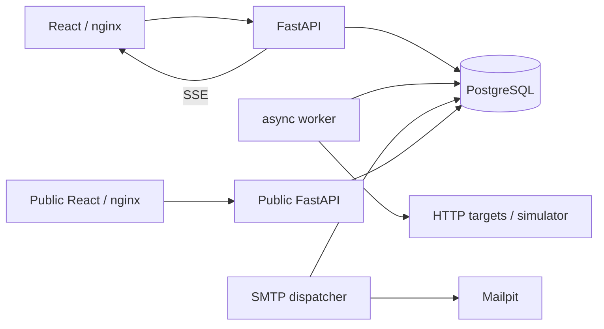

# Архитектура ServicePulse

Русская актуальная редакция от 21 октября 2026. Архитектура Phase6/0006 сохранена; локализация меняет представление, не API/schema/state machine. Исходное подробное описание предыдущей версии доступно в Git:f3866cd. Ограничения и результаты каждого этапа не переносятся автоматически на новый код.

## Компоненты и взаимодействие

| Компонент | Ответственность / граница |
|---|---|
| Administrative frontend/API | Локальное управление, реальные формы, version409, журнал, analytics, snapshots |
| Public frontend/API | Отдельный bundle/ASGI/nginx, только GET/public SSE, явная публикация и отдельное разрешение истории |
| Worker | HTTPX/asyncio, ограничение конкурентности 50, claim_due через FOR UPDATE SKIP LOCKED, lease/UUID/config fencing |
| Dispatcher | Отдельный процесс, persisted claim/prepare/send/ack, reconciliation каждые 2 с независимо от HTTP |
| PostgreSQL | Единственный источник настроек, наблюдений, incidents, maintenance, outbox, публикаций и scheduler state |
| Simulator/Mailpit | Управляемые реальные HTTP и локальная SMTP acceptance; никаких внешних писем |

nginx обновляет DockerDNS с TTL2 с после замены backendIP; SSE и URI сохраняются. Все опубликованные порты управления привязаны к 127.0.0.1. Auth отсутствует: Host allowlist не заменяет авторизацию. В production management нельзя публиковать без отдельной защиты.

## Модель данных, миграции 0001–0006

Monitor: UUID/name/url, interval30..3600, timeout0.1..120, expected_status100..599/body, threshold1..10/default2, state/streak, latestmetrics, next_due, lease_token/until, config_version, coalescedrunrequest. CheckResult хранит observationtimestamp, outcome/code/latency/boundederror и captured config_version/interval. FKcascade и composite(monitor_id,checked_at) поддерживают историю.

Group + MonitorGroup many-to-many + GroupRecipient с unique(group,email). Удаление группы сохраняет мониторы. Incident содержит opened/closed/recovered/closure; partialunique(monitor_id WHERE closed_at IS NULL) разрешает только один открытый инцидент. Constraints запрещают неполные и отрицательные времена; RECOVERED отличается от PAUSED/CONFIG_CHANGED.

MaintenanceWindow имеет ровно один target monitor/group, start/end UTC, end>start, target/timeindexes. NotificationEvent unique(incident_id,event_type), NotificationRoute фиксирует groupUUID/email, Delivery unique(event_id,email), status/attempts/due/lease/send_authorization/sent/boundederror. RoutegroupUUID намеренно не FK: предотвращает обратный порядок блокировок; отправка требует живых membership/recipient.0006 добавляет notification eligibility/obligation без угадывания legacyhistory.

PublicPage: disableddefault, slug/title/version; Publication: explicitmonitorconsent, unrelatedpublicID/publiclabel/show_history=false. Смена публикации не сбрасывает monitoringconfig/lease/incidents. Cascade удаление отзывает публикацию. Publicrole пока shared, чтение выполняется read-only transaction; это не role-levelleastprivilege.

## Состояния и конкуренция

UNKNOWN до первой проверки. Успех→UP/resetstreak. Ошибка сохраняет прежний UNKNOWN/UP до threshold; достижение порога→DOWN/openincident. Первый валидный успех закрывает RECOVERED. opened_at/checked_at фиксируются сразу после HTTP до ожидания DB lock; created_at отражает сохранение. Длительность clamp>=0 защищает от отката часов, HTTPlatency использует monotonicclock.

Пауза блокирует новые/manual запуски и закрывает PAUSED. Resume планирует сейчас, очищает streak, даёт UNKNOWN. Любой edit, включая rename, повышает config_version, очищает текущие метрики и закрывает CONFIG_CHANGED; история сохраняется. Старый leasedHTTP нельзя превратить в новый результат: проверки token/version/state выполняются до HTTP и при сохранении; истёкший preflight не начинает запрос. Лимит HTTP меньше lease. Простой не backfill и не DOWN.

Расписание fixed-delay: завершение persistence +interval. Медленный сайт не блокирует остальные asyncio tasks. Ручной запуск проходит ту же очередь/lease; запрос coalesced, не второй параллельный запуск. Worker отменяет задачи при shutdown; fencing исключает stalecommit. Транзакция monitor/result/incident/outbox атомарна; HTTP/SMTP выполняются вне долгой DB transaction.

Группа: среди неприостановленных DOWN>UNKNOWN>UP; пустая UNKNOWN, все PAUSED→PAUSED. Maintenance отдельный badge/политика и никогда не превращает DOWN в UP.

## Почтовая политика

Frozenroutes фиксируются на confirmation, sharedemail получает одну Delivery. Новые получатели действуют на будущие incidents; удаление routes отменяет ожидание. Полуинтервал start<=now<end; overlaps объединяются. Окно монитора блокирует всё, групповое только свой маршрут; допустимый независимый маршрут может отправить общее письмо.

Новые 0006 incidents сохраняют DOWN obligation вне maintenance даже если dispatcher опоздал и сайт восстановился; RECOVERY ждёт SENTDOWN. Полностью подавленный maintenance-only инцидент не требует stalepair. Конецокна при DOWN создаёт obligation без выдуманного CheckResult. Eligibility учитывает observationtime, не задержку persistence. Legacyunknown сохраняет историческую политику, backfill/mailstorm нет.

Порядок locks: parentgroups→sortedmonitors→windowchild; worker/dispatcher monitor→incident/delivery. Prepare перепроверяет route/window и сохраняет authorization до SMTP. Уже in-flightSMTP нельзя отозвать. Claimtokenfencesack; retry5..300s, максимум 8; permanent/exhaustionFAILED требует расследования. Crashafteraccept/beforeack может повторить физическое письмо; logicalevents остаются unique. Message-ID стабилен, но receiverdedup не гарантирован.

## SSE, публичность, аналитика

AdministrativeSSE каждые 2 с отправляет согласованный REPEATABLE READsnapshot; события groups/incidents/maintenance/overview инвалидируют ограниченные выборки. Reconnect получает полное состояние. Durations тикают локально каждуюсекунду. Два независимых клиента не требуют refresh.

Public проекция выбирает только разрешённые поля, не URL/privateID/name/email/rawerrors/outbox. Каждый GET/SSEtick проверяет enabled/membership/historyconsent заново. Unknown/disabled/denied404generic. No-store/no-replay; клиент очищает данные при disconnect/revoke и не принимает поздний REST поверх отозванного SSE. Уже полученные данные физически отозвать невозможно.

SQL analytics выполняет SET LOCAL jit=off +один boundedaggregateSELECT. Максимум 288/336/360buckets. Доступность = successful/observed; покрытие отдельно по capturedinterval spans с union/cap, manualbursts/equaltimestamps не удваивают время. LegacyNULLcadence не угадывается. NO DATA/null отличаются от реального 0; пропуски не соединяются и не становятся failures. Публичная freshness исключает PAUSED; staleDOWN остаётся последнимизвестным DOWN с предупреждением.

## Русское представление и тестирование

Frontendru.ts переводит только отображение enum/ошибок/периодов и nativevalidation; API fields, optionvalues, URLs, classes и protocolheaders английские. Даты используют ru-RU с локальным timezone. Сохранённые имена пользователя не переводятся. Русские SMTPbody/subject не меняют X-ServicePulse-Event, Message-ID, dedup/retrypolicy. Новых библиотек не добавлено.

Релевантная проверка: unit/component, PostgreSQLmigration/integration, realChromiumfourviewports/twoclients/reconnect/privacy/maintenance/Mailpit, freshCompose и outboxfaults. Нагрузочные данные 20 октября сохраняются отдельно; актуальные результаты русского этапа только в OWNER_FINAL_REPORT_RU.md и artifacts/ru-*.
